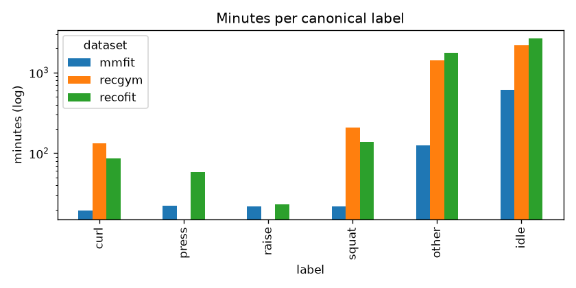
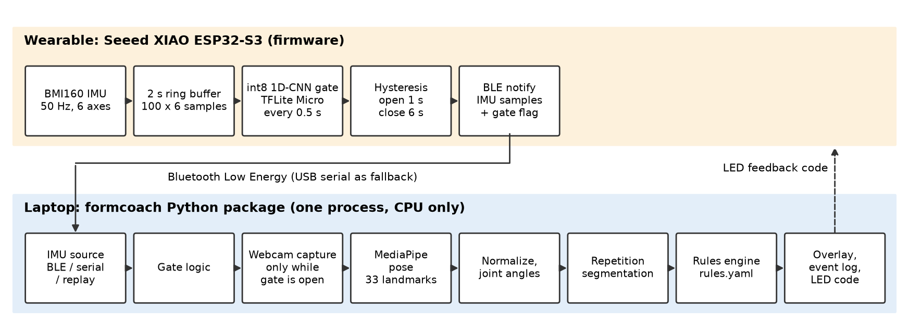

<!--
Team notes (not part of the submission; delete before export).

Abbreviated First Draft, written 2026-11-18 for submission on Canvas. It is cut down from
docs/report/draft.md, which stays the full working copy for the final report.

- Same rule as the full draft: every number comes from a file under reports/ or reports/logs/.
  If a number changes, change it in draft.md first, then here.
- What was cut: per-fold spreads, RecGym results, the rep-counting, rules and on-device tables
  (now one sentence each), three figures, the comparison-status table, most quality-issue and
  tooling detail, three references that are no longer cited. All of it is still in draft.md.
- Open [TODO]s are the same as in draft.md: SDSU emails, course title, instructor name, and whether the course needs a statement on
  AI-assisted development.
- Figures are linked by relative path. If the text is pasted into Word or Google Docs, insert
  docs/report/figures/architecture.png and reports/figures/data_profile_minutes.png by hand.
- Section 10: the bullets for Ruby, Rochelle and Bryce were written at Robert's direction on
  2026-11-18. Each member should read their own bullet and correct it before submission.
-->

# FormCoach: Wrist-IMU-Gated Pose Estimation for Per-Repetition Exercise Form Feedback

*First Draft*

| | |
|---|---|
| **Authors** | Robert Ashe (group leader), [TODO]@sdsu.edu · Ruby Rios Ramirez, [TODO]@sdsu.edu · Rochelle Reyes, [TODO]@sdsu.edu · Christian Byars, [TODO]@sdsu.edu · Bryce Hall, [TODO]@sdsu.edu |
| **Group name** | FormCoach |
| **Course** | BDA 696, [TODO: course title], San Diego State University, Fall 2026 |
| **Instructor** | [TODO: instructor name] |
| **Repository** | https://github.com/nthPerson/BDA696_Group_Project (public) |

## Abstract

People who lift weights alone get no feedback on their form. Camera-based pose estimation can
judge form, but running it on every frame is costly on an ordinary laptop and keeps a camera
recording when nothing is happening. FormCoach tests whether a low-cost wrist sensor can decide
*when* the camera needs to look. A wearable built by the team runs a small 8-bit neural network
that detects "exercise in progress" and signals a laptop over Bluetooth; only then does the laptop
run pose estimation, count repetitions, and apply rules that flag form faults on four dumbbell
exercises. The models are trained and evaluated on three public datasets (RecoFit, MM-Fit and
RecGym; 114 subjects), converted into one schema and cut into 597,453 labelled two-second windows.
On people never seen in training, a random forest detects exercise with macro-F1 0.87 against 0.67
for a motion-energy threshold; a 6,390-parameter convolutional network reaches 0.83 after 8-bit
quantization and runs in 13.4 ms on the microcontroller. In a first replay test, a gated pipeline
reproduced the feedback of always-on vision while processing 83% of the frames. Transfer to the
team's own sensor and a full-session benchmark are not yet measured. The contribution is an open
reference design for sensor-gated vision on commodity hardware.

**Keywords:** wearable inertial sensing; human activity recognition; pose estimation; TinyML;
sensor-gated computer vision; exercise form feedback

## 1. Introduction, Background and Objectives

Strength training at home is mostly unsupervised. Common form faults, such as a partial range of
motion or swinging the weight, are visible to an observer but not to the person lifting. A camera
with pose estimation can see them, but pose estimation on every frame is the dominant cost on a
laptop without a graphics card, and an always-on camera records far more than the task needs.
Wrist sensors have the opposite profile: they detect and count exercise cheaply (Morris et al.,
2014) but cannot judge posture. FormCoach combines the two, using the cheap sensor to decide when
the expensive model runs. The same pattern applies to any battery- or privacy-sensitive vision
system.

The building blocks exist. MediaPipe's pose model tracks body landmarks in real time on a CPU
(Bazarevsky et al., 2020), and TensorFlow Lite Micro with integer quantization runs small networks
on microcontrollers (David et al., 2021; Jacob et al., 2018). Labelled form faults do not exist
for our exercises (Parmar et al., 2022), so we do not train a fault classifier.

The hypothesis is that *sensor-gated vision produces the same per-repetition feedback as always-on
vision while processing a fraction of the camera frames.* Supporting it requires a gate that
generalizes to new people, accurate repetition counting, rules that pass correct repetitions and
flag faulty ones, and a model that fits on the microcontroller. Our approach is to learn only the
gate, from public data, and to judge form with transparent rules on a pretrained pose model. The
whole pipeline also runs on recorded sessions, so the analysis never depends on the hardware.

## 2. Data Sources and Acquisition

Three public datasets are used (Table 1). Together they hold about 29 million six-axis samples
from an inertial measurement unit (IMU), which measures acceleration and rotation. RecoFit
provides the many-subject cohort that makes unseen-subject evaluation meaningful. MM-Fit is the
only public set we found with wrist IMU, synchronized 3-D pose and repetition counts for all four
of our exercises. RecGym is a third cohort used as a robustness check.

**Table 1.** Public datasets (`reports/data_profile.md`).

| | RecoFit | MM-Fit | RecGym |
|---|---|---|---|
| Source | Morris et al. (2014) | Strömbäck et al. (2020) | Bian & Lukowicz (2025) |
| Subjects, duration | 94, 79.4 h | 10, 13.7 h | 10, 65.3 h |
| IMU | forearm, 50 Hz | two smartwatches, 100 Hz | wrist, pocket, leg; 20 Hz |
| Labels | 75 activities | 616 sets with repetition counts; 3-D pose | 12 workouts |
| Format, size | MATLAB, 3.1 GB | NumPy and CSV, 3.6 GB | CSV, 475 MB |
| License | CDLA-Permissive-2.0 | MIT | CC BY 4.0 |

One command per dataset downloads the files, verifies checksums, and records source, size and
license in a manifest; raw data is never committed. Three quality issues shaped the work. RecoFit
is severely imbalanced and its sensor sits on the forearm, not the wrist. MM-Fit has only 10
subjects. RecGym's signals are normalized to [0, 1], so physical units cannot be recovered and it
is never mixed with the other two. A fourth source, about one hour of recordings from team members
wearing our own device, is planned as a validation set; its video will stay on each owner's laptop.

## 3. Data Processing and Preparation

Three loaders convert the source formats into one schema in SI units, on one clock per session,
written as one Parquet file per recording (314 files). The 97 original activity labels are mapped
to six classes: curl, press, raise, squat, other exercise, and idle. All streams are resampled to
50 Hz, the rate of our device, and cut into two-second windows every second. Evaluation keeps the
597,453 windows in which at least 80% of the samples share one label.

Each window is stored twice: as the raw 100-by-6 signal for the neural network, and as 63
engineered features for tree models. The features are nine statistics (including dominant
frequency, spectral entropy and the autocorrelation peak) on the six axes and the acceleration
magnitude. Pose data is centred on the hips, scaled by torso length, smoothed, and reduced to
joint angles in degrees.

The workflow uses NumPy, pandas, PyArrow, SciPy and DuckDB. Each recording is processed
independently in a process pool, so memory stays near 3 GB and the full feature build takes about
35 seconds. At about 7 GB of raw data this was sufficient, and we did not need Dask or Spark. The
environment is locked, the random seed is fixed, and every step is one Makefile target.

## 4. Exploratory Data Analysis

Four findings from the profile report shaped later decisions.

*Class imbalance.* In RecoFit, idle time outweighs lateral raise by more than 100 to 1, and the
four target exercises are 6.5% of recorded time (Figure 1). We therefore report macro-F1, which
weights every class equally, and train with class weights.

*How much a gate can save.* Only 25% of MM-Fit recording time falls inside an exercise set, so a
perfect gate would process about a quarter of the camera frames.

*Signal structure.* Repetitions appear as a regular pattern with a period of one to two seconds,
while movement between sets is irregular but just as large. Motion energy alone cannot separate
the two, which motivated the frequency and autocorrelation features.

*Pose angles.* MM-Fit's 3-D pose compresses joint angles: the elbow moves between about 94° and
133° in a curl, far less than the anatomical range. Thresholds written from anatomy therefore fail
on this data, which drove both refinements in Section 6.

**Figure 1.** Minutes per class and dataset (log scale).

## 5. Methodology and System Architecture

Figure 2 shows the system. The wearable (a Seeed XIAO ESP32-S3 microcontroller with a Bosch BMI160
IMU, about $16 in parts) samples at 50 Hz, classifies the last two seconds every half second, and
opens the gate after one second of detected exercise and closes it after six seconds of idle. It
sends the samples and the gate state to the laptop over Bluetooth Low Energy. While the gate is
open, a Python application captures webcam frames, runs MediaPipe pose estimation, computes joint
angles, segments repetitions, applies the rules, and displays feedback.

**Figure 2.** System architecture. The dashed arrow is the feedback path to the wearable.

Three gate models are compared. The baseline is a threshold on the variance of acceleration
magnitude. The second is a random forest (scikit-learn; Pedregosa et al., 2011) with 200 trees on
the 63 features. The third is a one-dimensional convolutional network (CNN) on the raw window, with
three convolution layers and 6,390 parameters, trained in Keras with rotation and timing
augmentation to tolerate differences in sensor placement. For the device it is quantized to 8-bit
integers (int8) and run by TensorFlow Lite Micro.

Repetitions are counted from pose as excursions of each exercise's main joint angle. Form is
judged by 16 rules held in a configuration file; each compares one measurement of a repetition,
such as trunk lean or elbow drift, with a threshold and returns a coaching message.

This split fits the problem. The gate has abundant labelled data and a hard memory limit, which
suits a tiny learned model. Form judgement has no labels, so rules are the approach that can be
tested honestly.

## 6. Baselines, Comparisons and Refinement

The energy threshold is the baseline because it is the gate that costs nothing; a model must beat
it to earn its place in the microcontroller's memory. The forest and the CNN compare hand-crafted
features against learned features that can be deployed. At the system level, always-on vision is
the baseline for the gated pipeline, on identical recordings.

Three refinements have been made. First, the pose repetition counter used fixed angle thresholds
and counted nothing on MM-Fit; thresholds that adapt to the recent range of the angle fixed this.
Second, rule thresholds are now calibrated per pose source from the 5th and 95th percentiles of
correct repetitions, and a provisional set exists for the webcam. Third, we planned
quantization-aware training if int8 conversion cost more than two points of macro-F1; it cost 0.5,
so it was not needed. Hyperparameter tuning and ablations have not been done yet.

## 7. Evaluation and Results

All results are on subjects the model never saw in training, and are generated by scripts into
`reports/`.

**Table 2.** Gate and exercise recognition on unseen subjects (`reports/loso_*.md`,
`reports/transfer_rf_*.md`). The four RecoFit gate rows share five subject-grouped folds; the other
rows hold out one subject at a time.

| Task | Model | Train → test | Accuracy | Macro-F1 |
|---|---|---|---|---|
| Gate | Energy threshold (baseline) | RecoFit | 0.688 | 0.668 |
| Gate | Random forest | RecoFit | 0.872 | 0.867 |
| Gate | CNN, float | RecoFit | 0.840 | 0.837 |
| Gate | CNN, int8 | RecoFit | 0.835 | 0.832 |
| Gate | Random forest | MM-Fit | 0.954 | 0.935 |
| Gate | Random forest | RecoFit → MM-Fit | 0.770 | 0.741 |
| Exercise | Random forest | RecoFit | 0.951 | 0.797 |
| Exercise | Random forest | MM-Fit | 0.970 | 0.950 |
| Exercise | Random forest | RecoFit → MM-Fit | 0.600 | 0.333 |

**Gate.** Both learned models clearly beat the baseline, which detects only half of the exercise
windows. The forest leads the CNN by three points, but the two detect about the same share of
exercise windows (79% and 80%); the difference is that the CNN opens falsely on 13% of idle windows
against 7%. For a gate these errors are not equal: a missed window can lose a repetition, while a
false opening only wastes frames. On the costlier error the deployable model is level with the
forest.

**Transfer.** Within a dataset, recognition generalizes to new people. Across datasets it does
not: trained on RecoFit and tested on MM-Fit, exercise recognition falls from 0.95 to 0.33. The
sensor moves from forearm to wrist, and the features do not survive the change. Our wearable is a
third placement, so models trained on public data cannot be assumed to work on it. This is why the
device model is trained on both datasets with rotation augmentation, and why the team recordings
matter.

**Repetitions and rules.** Against MM-Fit's labelled counts, pose-based counting has a mean error
of 0.03 to 0.22 repetitions per set for curl, raise and squat, and 0.97 for press, where it loses
about one repetition per set. A peak-detection baseline on the IMU has errors of 0.69 to 3.71. The
rules were tested on 2,320 MM-Fit repetitions, taken as correct form, and on the same repetitions
with synthetic faults applied. With thresholds written from anatomy, only one of eleven tested
rules both passed correct repetitions and caught the fault. Several range-of-motion rules fired on
every repetition. The rule engine works; the thresholds do not transfer between pose sources.

**Gated versus always-on vision.** Table 3 is the first test of the hypothesis, on one 30-second
session.

**Table 3.** Gating on one replayed MM-Fit session with ten curls (`reports/gating.md`).

| Gate | Frames processed | Repetitions | Faults | Same feedback |
|---|---|---|---|---|
| Always-on (baseline) | 99.9% | 10 | 25 | (reference) |
| Energy threshold | 82.9% | 10 | 25 | yes |
| Random forest on laptop | 79.2% | 9 | 22 | no |

The energy gate reproduced every repetition and fault while skipping 17% of the frames. The model
gate skipped more but lost one repetition at a gate boundary, which changes the feedback. The
session was cut closely around one set, so it understates the possible saving.

**On the device.** The int8 model is 16.8 KB, uses 6.2 KB of a 40 KB working-memory budget, and
runs in 13.4 ms, under 3% of the half-second between inferences. Four wearables are assembled and
stream at 50 Hz without dropped samples. The live application runs pose estimation on a webcam at
about 30 frames per second.

**Not yet measured.** Transfer to our own sensor from the team recordings, gating on full sessions
with the on-device gate and live pose estimation, rule performance under calibrated thresholds,
feedback latency, and battery life.

## 8. Discussion, Applications and Limitations

A learned gate clearly beats an energy threshold on new people, and the version small enough for a
$16 wearable gives up accuracy only through extra false openings, which waste frames but do not
lose repetitions. Pose-based counting is accurate for three of four exercises. The form rules are
not yet valid: each threshold is a claim about a particular pose model and camera, and must be
calibrated for it.

The hypothesis is open. One test shows that identical feedback at lower cost is achievable, and
also how it fails: a gate that is closed at the wrong moment drops a repetition. A gate should
therefore be tuned to open quickly and to stay open when in doubt.

Beyond home fitness, the design could track range of motion between physical-therapy visits. More
generally, a cheap always-on sensor that gates an expensive model is a pattern for saving energy
and limiting recording in smart cameras and monitoring systems.

The main limitations are data and labels. Only 10 subjects have pose data, and none of the public
sensors is ours. There are no real fault labels, so rule sensitivity rests on synthetic faults that
may not resemble real ones. The planned team recordings are small and come from the developers.
The system covers four exercises from a single frontal camera.

On privacy, gating reduces the time the camera is on, team video never leaves its owner's machine,
and subjects are coded. FormCoach is a training aid, not a medical device, and its messages are
conservative because wrong feedback could encourage a wrong movement.

## 9. Conclusion and Future Work

Unsupervised strength training lacks form feedback, and always-on vision is a costly way to
provide it. We built a system in which a wrist sensor decides when the camera looks: a
reproducible pipeline over three public datasets, a gate in three variants, a pose and rules
pipeline, firmware, and an evaluation harness. On unseen subjects the learned gate reaches macro-F1
0.83 to 0.87 against 0.67 for the baseline, and the deployable version runs in 13.4 ms on the
microcontroller. Neither models nor rule thresholds transferred between sensing conditions, which
makes the team recordings the decisive remaining measurement. The contribution is an open reference
design for sensor-gated form feedback.

Possible extensions include a learned fault classifier if labelled data becomes available,
personalization from a few of a user's repetitions, more exercises and camera views, and coaching
sentences generated from fault codes by a local language model.

## 10. Team Contributions

- **Robert Ashe (group leader):** system architecture and repository; data pipeline; gate models
  and evaluation harness; rules engine; firmware; assembly and testing of the wearables; report
  outline and draft.
- **Christian Byars:** live webcam application; first MediaPipe runs; labelled webcam test sets
  and the provisional webcam thresholds.
- **Ruby Rios Ramirez:** form-feedback rules and the exercise and health perspective behind them
  (which faults matter and how the coaching messages are worded); revision and submission of the
  report outline.
- **Rochelle Reyes:** project scoping and the pitch presentation; took part in the wearable build
  and bench-testing sessions; review of the outline and of the pose and form-feedback sections.
- **Bryce Hall:** project scoping and the pitch presentation; took part in the wearable build and
  bench-testing sessions; review and editing of the outline and report draft.

## 11. References

Bazarevsky, V., Grishchenko, I., Raveendran, K., Zhu, T., Zhang, F., & Grundmann, M. (2020).
*BlazePose: On-device real-time body pose tracking* (arXiv:2006.10204). arXiv.
https://doi.org/10.48550/arXiv.2006.10204

Bian, S., & Lukowicz, P. (2025). *RecGym: Gym workouts recognition dataset with IMU and
capacitive sensor* [Data set]. UCI Machine Learning Repository. https://doi.org/10.24432/C5PW4K

David, R., Duke, J., Jain, A., Janapa Reddi, V., Jeffries, N., Li, J., Kreeger, N., Nappier,
I., Natraj, M., Wang, T., Warden, P., & Rhodes, R. (2021). TensorFlow Lite Micro: Embedded
machine learning for TinyML systems. *Proceedings of Machine Learning and Systems, 3*, 800–811.

Jacob, B., Kligys, S., Chen, B., Zhu, M., Tang, M., Howard, A., Adam, H., & Kalenichenko, D.
(2018). Quantization and training of neural networks for efficient integer-arithmetic-only
inference. In *Proceedings of the IEEE Conference on Computer Vision and Pattern Recognition*
(pp. 2704–2713). https://doi.org/10.1109/CVPR.2018.00286

Morris, D., Saponas, T. S., Guillory, A., & Kelner, I. (2014). RecoFit: Using a wearable
sensor to find, recognize, and count repetitive exercises. In *Proceedings of the SIGCHI
Conference on Human Factors in Computing Systems* (pp. 3225–3234). ACM.
https://doi.org/10.1145/2556288.2557116

Parmar, P., Gharat, A., & Rhodin, H. (2022). Domain knowledge-informed self-supervised
representations for workout form assessment. In *Computer Vision – ECCV 2022* (pp. 105–123).
Springer. https://doi.org/10.1007/978-3-031-19839-7_7

Pedregosa, F., Varoquaux, G., Gramfort, A., Michel, V., Thirion, B., Grisel, O., … Duchesnay,
É. (2011). Scikit-learn: Machine learning in Python. *Journal of Machine Learning Research,
12*, 2825–2830.

Strömbäck, D., Huang, S., & Radu, V. (2020). MM-Fit: Multimodal deep learning for automatic
exercise logging across sensing devices. *Proceedings of the ACM on Interactive, Mobile,
Wearable and Ubiquitous Technologies, 4*(4), 1–22. https://doi.org/10.1145/3432701

## 12. Appendix and Reproducibility

All code, firmware and documentation are in the public repository,
https://github.com/nthPerson/BDA696_Group_Project. It contains no raw datasets, team video,
credentials or keys. From a fresh clone, `make setup`, `make data`, `make features`,
`make train-gate` and `make eval` regenerate every table and figure under `reports/`, and
`make demo` runs the full pipeline on a recorded public session without hardware. Each report
records the command, code commit and seed that produced it. Per-fold results, the remaining
result tables, and the design decisions are in `reports/` and `docs/`.
