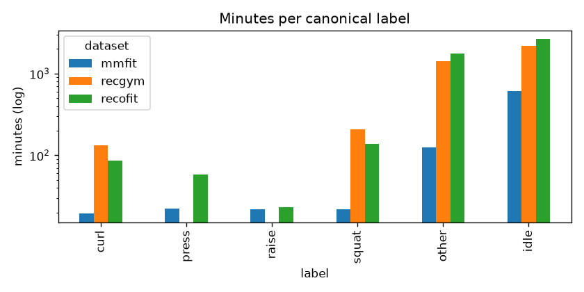
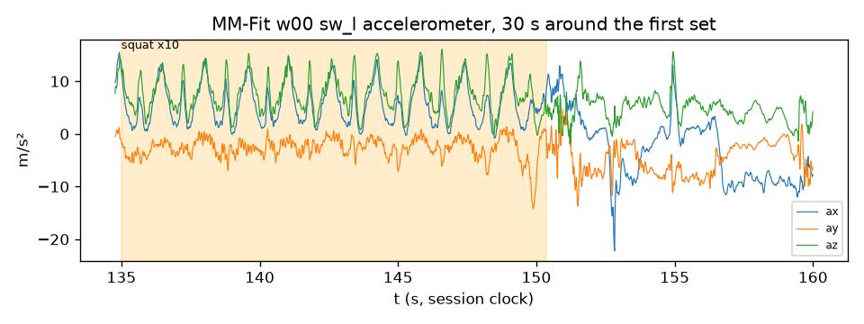
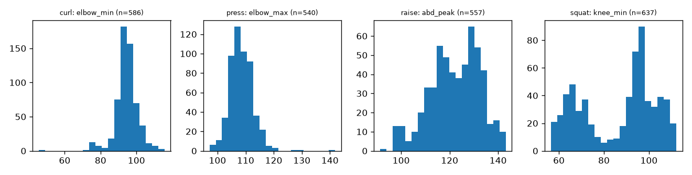
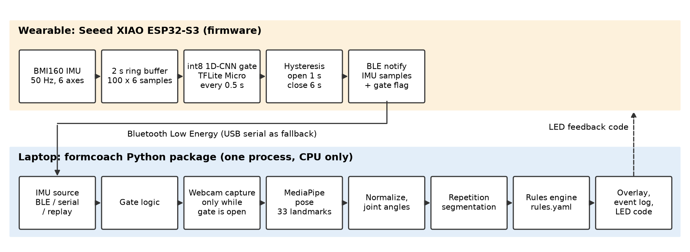
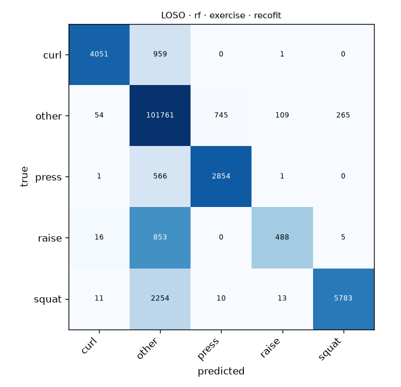

<!--
Team notes (not part of the submission; delete before export).

First Draft of the written report, generated 2026-11-12 from the approved outline
(docs/report/outline.md) and the files under reports/. Rules for editing:

- Every number comes from a file under reports/ (named next to each table) or from the device
  self-test logs under reports/logs/. Recall and false-open rates in Table 4 are computed from the
  pooled confusion matrices in those reports. Do not type in a number that no script produced.
- [TODO] = information only the team has. [TBD] = a measurement that has not been run yet.
- Open [TODO]s: SDSU emails, course title, instructor name, the Team Contributions bullets for
  Ruby, Rochelle and Bryce, and whether the course needs a statement on AI-assisted development
  (most of the code was written with Claude Code, see docs/STATUS.md).
- Open [TBD]s, in the order they unblock the paper: team validation recordings and transfer
  (Table 10), gating benchmark on full sessions with the on-device gate and real pose inference
  (Table 8), rule pass/detection rates under the calibrated thresholds (Table 7), feedback latency,
  battery life, pose-model ablation, CNN on the exercise task, tuning and ablations (Section 6.3),
  the remaining EDA figures (Section 4).
- Figures: Figure 4 (architecture) is drawn by docs/report/figures/make_architecture.py. The others are the
  generated PNGs under reports/figures/ and are linked by relative path, which renders on GitHub
  and in the VS Code preview. If the text is pasted into Word or Google Docs, insert the PNGs by hand.
-->

# FormCoach: Wrist-IMU-Gated Pose Estimation for Per-Repetition Exercise Form Feedback

*First Draft*

| | |
|---|---|
| **Authors** | Robert Ashe (group leader), [TODO]@sdsu.edu · Ruby Rios Ramirez, [TODO]@sdsu.edu · Rochelle Reyes, [TODO]@sdsu.edu · Christian Byars, [TODO]@sdsu.edu · Bryce Hall, [TODO]@sdsu.edu |
| **Group name** | FormCoach |
| **Course** | BDA 696, [TODO: course title], San Diego State University, Fall 2026 |
| **Instructor** | [TODO: instructor name] |
| **Repository** | https://github.com/nthPerson/BDA696_Group_Project (public) |

## Abstract

People who lift weights alone get no feedback on their form. Camera-based pose estimation can
judge form, but running it continuously is the largest computing cost on an ordinary laptop and
keeps a camera recording when nothing is happening. FormCoach tests whether a low-cost wrist
sensor can decide *when* the camera needs to look. A wearable built by the team (a Seeed XIAO
ESP32-S3 microcontroller with a Bosch BMI160 six-axis inertial measurement unit, or IMU) runs a
small 8-bit neural network that detects "exercise in progress" and sends that signal over
Bluetooth Low Energy to a Python application. Only while this gate is open does the laptop run
MediaPipe pose estimation on the webcam, compute joint angles, segment repetitions, and apply
biomechanical rules that flag faults such as elbow swing on a curl. The scope is four dumbbell
exercises: bicep curl, overhead press, lateral raise and squat.

The learned components are trained and evaluated on three public datasets: RecoFit (94 subjects,
79 hours of forearm IMU data), MM-Fit (10 subjects, smartwatch IMU with synchronized 3-D pose and
repetition counts) and RecGym (10 subjects, 4.7 million rows). A reproducible workflow converts
their three file formats into one Parquet schema in SI units, resamples to 50 Hz, and produces
597,453 labelled two-second windows with 63 engineered features each. On subjects never seen in
training, a random forest detects exercise with macro-F1 0.87 on RecoFit, against 0.67 for a
motion-energy threshold; a 6,390-parameter convolutional network reaches 0.84, and 0.83 after 8-bit
quantization. The quantized model occupies 16.8 KB and runs in 13.4 ms on the microcontroller.
Pose-based repetition counting is within 0.25 repetitions per set for three of the four exercises.
In a first replay test, gating with the energy threshold reproduced every repetition and fault of
always-on vision while processing 83% of the frames. Several rule thresholds written from
anatomy fired on nearly every correct repetition and had to be calibrated per pose source. The full-session gating
benchmark, feedback latency, and transfer to the team's own sensor are not yet measured. The
contribution is an open reference design for sensor-gated vision on commodity hardware.

**Keywords:** wearable inertial sensing; human activity recognition; pose estimation; TinyML;
sensor-gated computer vision; exercise form feedback

## 1. Introduction, Background and Objectives

**Problem and motivation.** Strength training at home is mostly unsupervised. The common form
faults (partial range of motion, swinging the weight, leaning the trunk, knees collapsing inward,
rushed tempo) are visible to an observer but not to the person lifting. Vision-based coaching can
see them, but pose estimation on every frame is the dominant cost on a laptop without a graphics
card, and an always-on camera records far more than the task needs. Wrist sensors have the
opposite profile: smartwatches detect and count exercise cheaply, but cannot judge posture. This
project combines the two, using the cheap sensor to decide when the expensive model runs.

**Background.** Morris et al. (2014) showed with RecoFit that one arm-worn IMU can find, recognize
and count gym exercises. Strömbäck et al. (2020) released MM-Fit, which pairs smartwatch IMU data
with video and 3-D pose, and Bian et al. (2022) added capacitive sensing to IMU-based gym
recognition (the RecGym data). Deep models on raw sensor windows are now standard for activity
recognition (Ordóñez & Roggen, 2016; Wang et al., 2019). On the vision side, BlazePose, the model
behind MediaPipe, tracks body landmarks in real time on a CPU (Bazarevsky et al., 2020). TensorFlow
Lite Micro (David et al., 2021) and integer-only quantization (Jacob et al., 2018) make it possible
to run small networks on microcontrollers. Learned form assessment exists, but its labels cover
only a few barbell lifts and are access-restricted (Parmar et al., 2022), which is why we do not
train a fault classifier.

**Users.** The intended user trains alone with light dumbbells and a laptop. A second audience is
engineers building battery- or privacy-sensitive vision systems, for whom the same pattern applies:
a cheap always-on sensor decides when an expensive model runs.

**Objectives.** The primary objective is an end-to-end system in which a wrist-worn gate model
wakes a pose pipeline that gives feedback on each repetition. The hypothesis under test is that
*sensor-gated vision produces the same per-repetition feedback as always-on vision while processing
a fraction of the camera frames on a laptop CPU.* Four supporting objectives follow from it: a gate
that generalizes to people it has not seen, accurate repetition segmentation, rules that pass
correct repetitions and flag faulty ones, and an 8-bit (int8) model that fits and runs in real
time on the microcontroller.

**Approach.** Every learned component is trained and evaluated on public data, and the whole
pipeline runs on recorded sessions without hardware (`--source replay`), so the hardware never
blocks the analysis. Only the gate is learned. Form judgement is rule-based on top of a pretrained
pose model, because no public dataset labels form faults for our exercises. A short recording
session with our own wearables is a validation set for transfer to our sensor, not training data.

## 2. Data Sources and Acquisition

Table 1 summarizes the three public datasets. Together they hold about 29 million six-axis IMU
samples from 114 subjects, well above the course guideline of 25,000 observations by 15 features.

**Table 1.** Public datasets used (`reports/data_profile.md`).

| | MM-Fit | RecoFit | RecGym |
|---|---|---|---|
| Source | mmfit.github.io (Strömbäck et al., 2020) | Microsoft GitHub repository, Git LFS (Morris et al., 2014) | UCI ML Repository (Bian & Lukowicz, 2025) |
| Subjects | 10 | 94 | 10 |
| Recordings | 21 workouts, 13.7 h per watch | 126 lab visits, 79.4 h | 50 sessions, 3 sensor positions, 65.3 h |
| IMU | two smartwatches, 100 Hz, m/s² and rad/s | right forearm, 50 Hz, g and deg/s | wrist, pocket, leg; 20 Hz, normalized |
| Other modalities | phones, earbud, 2-D and 3-D pose at 30 fps, RGB-D video | none used | body capacitance (dropped) |
| Labels | 616 sets with start, end, activity and repetition count | 75 activity labels, repetition counts on many segments | 12 workout labels |
| Format and size | per-workout NumPy arrays and a CSV; 1.74 GB archive, 3.6 GB extracted; video 40.8 GB | two MATLAB v5 files, 1.57 GB each | one 475 MB CSV, 4,703,320 rows |
| License | MIT (video CC BY 4.0) | CDLA-Permissive-2.0 | CC BY 4.0 |
| Role | pose, repetition counts, cross-dataset test | gate and exercise-recognition training | within-dataset robustness check |

**Why these data fit.** RecoFit provides the many-subject cohort that makes unseen-subject
evaluation meaningful. MM-Fit is the only public set we found with synchronized wrist IMU, pose
and repetition counts for all four of our exercises (squats, bicep curls, dumbbell shoulder press,
lateral shoulder raises). RecGym adds a third cohort with curl and squat.

**Acquisition.** One command per dataset (`make data DATASET=…`) downloads the files, verifies
SHA-256 checksums, and records URL, checksum, size, license and date in `data/MANIFEST.md`. Raw
data is never committed; small fixtures, including a 30-second MM-Fit session, are committed for
tests. The RecoFit files are Git LFS objects and must be fetched from the media endpoint. The UCI
copy of RecGym is served corrupt (its first 60 MB are zero bytes), so we fetch the authors' Kaggle
mirror of the same file.

**Quality concerns.** The RecoFit documentation claims over 200 participants, but the release
holds 94. Its classes are severely imbalanced, and 78 minutes carry junk labels such as device taps
and arm-band adjustment. Its sensor sits on the forearm, not the wrist. MM-Fit has only 10
subjects, lacks the left-phone stream in 15 of 21 workouts, and contains duplicated timestamps.
Every RecGym signal is min–max normalized to [0, 1] without timestamps, so physical units and
gravity cannot be recovered; RecGym is therefore evaluated only within itself and never mixed with
the SI-unit data. We have not yet downloaded the MM-Fit video: the 3-D pose that the MM-Fit authors
derived from it is sufficient for the pose pipeline so far.

**Team validation recordings.** About one hour from five team members (coded S1–S5) wearing our
device is planned: per person, two correct-form sets of each exercise plus one set with a scripted
fault. Webcam video stays on its owner's laptop; only derived pose and IMU files are shared. The
recording protocol is written but the recordings have not been made [TBD].

## 3. Data Processing and Preparation

**Ingest and conversion.** Three loaders (`scipy.io.loadmat` for the MATLAB structs, NumPy for the
arrays, pandas for the CSV) emit one schema: dataset, subject, session, device, placement, time in
seconds, three accelerometer axes in m/s², three gyroscope axes in rad/s, exercise label, set and
repetition identifiers. RecoFit is converted from g and deg/s; RecGym is tagged
`units = normalized`. MM-Fit streams and pose are placed on one clock per workout, fitted from the
video frame index and timestamp, and duplicated timestamps are dropped. The 75 RecoFit, 10 MM-Fit
and 12 RecGym labels are mapped to six canonical classes (curl, press, raise, squat, other, idle);
the original label is kept for traceability and junk-labelled spans are excluded. The output is one
Parquet file per visit or workout, 314 files in total, written in 41 seconds.

**Profiling and validation.** `formcoach data profile` generates a report of subjects, sessions,
minutes per label, sampling rate per device, missing modalities and duplicate timestamps. Schema
checks run as unit tests, and every generated report records its command, code commit and random
seed.

**Windowing and features.** All streams are resampled to 50 Hz, the device rate, with anti-alias
filtering. Two-second windows (100 samples by 6 channels) are cut every second. Each carries its
majority label and a purity score, and evaluation keeps windows that are at least 80% one label.
Nine statistics are computed on seven channels (the six axes and the acceleration magnitude |a|),
giving 63 features: mean, standard deviation, minimum, maximum, energy, dominant frequency
(0.3–8 Hz), spectral entropy, and the lag and height of the autocorrelation peak (0.3–3 s). The raw
window is stored beside the features, so tree models and the neural network read the same files.
The network's per-channel standardization constants are computed on training data and compiled
into the firmware, so the device and the laptop preprocess identically. Table 2 gives the result.

**Table 2.** Labelled windows after purity filtering (`reports/loso_*_active_*.md`).

| Dataset | Windows | Active | Idle |
|---|---|---|---|
| RecoFit | 276,080 | 120,800 | 155,280 |
| MM-Fit | 95,849 | 23,955 | 71,894 |
| RecGym | 225,524 | 100,078 | 125,446 |

**Pose processing.** Pose frames are centred on the hips and scaled by torso length, so that
measurements are comparable across people and camera distances. Frames whose required landmarks
are poorly visible are dropped, gaps of up to three frames are interpolated, and the series is
smoothed with a median and a Savitzky–Golay filter. Joint angles (elbow, shoulder abduction, hip,
knee, trunk inclination, knee tracking) are computed in degrees. The same code handles two
skeletons: MM-Fit's 17-joint 3-D pose and MediaPipe's 33 landmarks from a webcam.

**Scalability and tools.** The workflow uses NumPy, pandas, PyArrow, SciPy, DuckDB for queries over
Parquet, OpenCV, and `concurrent.futures` process pools. Each visit or workout is processed
independently, so memory stays bounded (about 3 GB peak, while a RecoFit file loads) and the
feature build parallelizes across cores (about 35 seconds for all datasets on 14 workers). We
considered Dask and PySpark; at about 7 GB of raw sensor data, partitioned Parquet with process
parallelism is sufficient and has fewer moving parts. The environment is pinned with a `uv`
lockfile, the seed is fixed (20260924), and each step is one Makefile target.

## 4. Exploratory Data Analysis

**Class imbalance.** Figure 1 shows minutes per canonical label on a log scale. In RecoFit, idle
time (2,642 minutes) outweighs lateral raise (23 minutes) by more than 100 to 1, and the four
target exercises together are 305 of 4,692 recorded minutes (6.5%). This is why macro-F1, which
weights every class equally, is the primary metric, why both learned models use class weights, and
why an "other exercise" class exists. RecGym has no press or raise, which limits it to curl and
squat.

**Figure 1.** Minutes per canonical label and dataset (log scale).

**How much a gate can save.** In MM-Fit, only 210 of 823 recorded minutes (25%) fall inside a
labelled exercise set. A perfect gate on such a workout would therefore process about a quarter of
the camera frames, which sets the scale of the saving the hypothesis is about.

**Missingness and timing.** The left phone is absent in 15 of 21 MM-Fit workouts, and the earbud and
right-phone streams carry over a million duplicated timestamps each, against 21,000–28,000 on each
watch. The watches also run slightly fast (103–104 Hz against a nominal 100 Hz). We therefore use
only the two smartwatch streams, drop duplicates, and resample to a uniform 50 Hz grid.

**Signal structure.** Figure 2 shows a set of ten squats followed by rest. The repetitions appear
as a regular pattern with a period of about 1.5 seconds. The movement after the set is irregular
but just as large in amplitude. A threshold on motion energy cannot separate the two, which
motivates the periodicity features (dominant frequency, autocorrelation peak) and predicts the
energy baseline's main weakness, false openings (Section 7.1).

**Figure 2.** MM-Fit left-watch accelerometer around one set of ten squats (shaded).

**Repetition kinematics.** Figure 3 shows the main joint measurement per exercise over 2,320
MM-Fit repetitions. MM-Fit's 3-D pose, which is lifted from video, compresses joint angles: the
elbow moves between medians of 94° and 133° during a curl, and reaches a median of only 108° at
the top of a press, far from an anatomical lockout near 180°. Squat depth is bimodal, with modes
near 65° and 97° of knee angle. Repetitions are also quick, with median durations of 0.94 to
1.35 seconds. These findings drove two design changes described in Section 6.3: adaptive
segmentation thresholds, and rule thresholds calibrated per pose source.

**Figure 3.** Distribution of the primary joint measurement per exercise on MM-Fit repetitions
(degrees).

**Subject coverage.** Many RecoFit subjects performed only one or two of the four target
exercises, so per-subject scores for exercise recognition vary widely (median macro-F1 0.61,
minimum 0.27, against 0.80 pooled). We therefore report results pooled over folds and give the
per-fold spread beside them.

**Not yet produced [TBD].** The outline also planned a per-subject coverage heat map, a
cross-dataset comparison of gravity direction and feature distributions (PCA), and a feature
correlation matrix. The cross-dataset shift is so far measured only through the transfer
experiment in Section 7.2.

## 5. Methodology and System Architecture

**Architecture.** Figure 4 shows the two halves of the system. On the wearable, the IMU is sampled
at 50 Hz into a two-second buffer; every 0.5 seconds the int8 network classifies the buffer, and a
hysteresis rule opens the gate after two consecutive active windows (1 s) and closes it after 6 s
of idle. IMU samples and the gate flag are sent as Bluetooth Low Energy notifications. On the
laptop, a single Python process reads the IMU stream from Bluetooth, USB serial, or a recorded
session. While the gate is open it captures webcam frames, runs MediaPipe PoseLandmarker, computes
joint angles, segments repetitions, applies the rules, and shows the result on an overlay; a
feedback code is sent back to the wearable's LED. Every stage reads and writes the same Parquet
schemas, which is what allows the full pipeline to run on recorded sessions.

**Figure 4.** System architecture. The dashed arrow is the feedback path to the wearable.

**Gate and exercise models.** The input is one two-second window. The gate output is binary
(exercise in progress or not); the exercise output is one of curl, press, raise, squat, other.
Three models are compared. The baseline is a threshold on the variance of |a| over the window,
with its one parameter chosen to maximize balanced accuracy on the training subjects. The second
is a random forest (scikit-learn; Pedregosa et al., 2011) with 200 trees and balanced class weights
on the 63 features. The third is a one-dimensional convolutional network (CNN) in Keras on the raw
window: three convolution layers (16, 32 and 32 filters) with max pooling, global average pooling,
and a dense softmax output, 6,390 parameters in total. The model on the device is a single
six-class network (the five exercise classes plus idle); the gate is open when it predicts any
class other than idle. It is trained with class weights, Adam and
early stopping, and with augmentation aimed at differences in sensor placement: random 3-D
rotation up to 30°, time warping, jitter and magnitude scaling. For deployment the CNN is converted
by post-training full-integer quantization to a TensorFlow Lite model, which is compiled into the
firmware and executed by TensorFlow Lite Micro.

**Repetition segmentation.** On the IMU, a band-pass filter (0.3–3 Hz) followed by peak detection
counts repetitions. On pose, a repetition is one excursion of the exercise's primary joint angle
between an enter and an exit threshold. The thresholds adapt to the 10th and 90th percentiles of
the last six seconds of that angle. Fusion accepts a repetition when the IMU and pose intervals
overlap by at least half.

**Rules engine.** Form rules are data, not code: a YAML file holds 16 rules across the four
exercises (for example `CURL_SWING`, `PRESS_NO_LOCKOUT`, `RAISE_OVER`, `SQUAT_SHALLOW`,
`SQUAT_KNEE_VALGUS`, and a tempo rule per exercise). Each rule compares one per-repetition
measurement with a threshold and returns a code, a severity, the measured value and a one-sentence
coaching message. A repetition can carry several faults.

**Why this design.** The gate is a well-posed supervised problem with a large amount of labelled
public data, and it must fit a 40 KB memory budget on the microcontroller; hence a very small CNN,
compared against a strong feature-based model. For form judgement there are no fault labels to
learn from, so transparent rules on a pretrained pose model are the approach that can be tested
honestly.

**Implementation.** The laptop side is a Python 3.11 package with a command-line interface
(`formcoach`), using scikit-learn, TensorFlow/Keras, MediaPipe, OpenCV, SciPy, pandas, PyArrow,
DuckDB, `bleak` for Bluetooth and `typer`. The firmware uses PlatformIO with the Arduino framework,
NimBLE and TensorFlow Lite Micro, and our own BMI160 driver. A suite of 378 automated tests runs
in continuous integration on Linux, macOS and Windows.

## 6. Baselines, Comparisons and Refinement

### 6.1 Comparisons

Six comparisons were planned, each against a defined baseline. Table 3 gives their status.

**Table 3.** Planned comparisons and their status in this draft.

| Component | Baseline | Alternatives | Status |
|---|---|---|---|
| Gate | motion-energy threshold | random forest, CNN, CNN int8 | done on identical unseen-subject folds (Table 4) |
| Exercise recognition | none (majority class is "other") | random forest; CNN | forest done (Table 5); CNN [TBD] |
| Repetition counting | IMU peak detection | pose, IMU + pose fusion | peaks and pose done (Table 6); fusion on one session only |
| Rule thresholds | values written from anatomy | calibrated per pose source | design values evaluated (Table 7); calibrated [TBD] |
| System | always-on vision | energy gate, laptop model gate, on-device gate | one 30 s session, no on-device gate yet (Table 8) |
| Pose model | MediaPipe Lite | Full, Heavy | [TBD] |

### 6.2 Why these comparisons

The energy threshold is what a gate costs nothing to build, so beating it shows that a model earns
its place in the microcontroller's memory. Comparing the forest with the CNN weighs hand-crafted
features, which cannot be deployed as they are, against learned features that can be quantized to
run on the device. Comparing gated with always-on vision on identical recordings isolates the
effect of the gate on cost while holding the feedback fixed.

### 6.3 Refinements made so far

**Adaptive segmentation thresholds.** The first pose segmenter used fixed angles from anatomy
(for a curl, elbow below 60° then above 150°). Because MM-Fit pose compresses angles (Section 4),
these thresholds never fired and no repetition was counted. Replacing them with thresholds that
adapt to the recent range of the angle counted 2,320 repetitions against 2,395 labelled
(Section 7.3).

**Rule calibration per pose source.** For the same reason, range-of-motion rules written from
anatomy flagged nearly every correct repetition (Section 7.4). The evaluation command now writes a
second rules file whose thresholds sit at the 5th or 95th percentile of the correct-form MM-Fit
repetitions. The first webcam runs repeated the lesson on a third pose source: under the original
values, 0 of 54 curls by one team member were judged good. A provisional webcam rules file for the
curl was then tuned and checked on new labelled sets from the same person, where 16 of 16 strict
curls passed and 15 of 16 deliberately swung curls were flagged. A half-range set was inconclusive.
These webcam numbers come from one person in one session and are not a validation.

**Quantization.** We planned quantization-aware training if int8 conversion cost more than two
points of macro-F1. Post-training quantization cost 0.5 points (Table 4), so it was not needed.

**Like-for-like folds.** Training the CNN once per subject (94 times) was not affordable, so it is
evaluated on five subject-grouped folds. The baseline and the forest were re-run on exactly those
folds so that Table 4 compares models on identical test subjects.

**Not yet done [TBD].** Hyperparameter tuning with Optuna, feature and augmentation ablations, a
sweep of the hysteresis constants, and longer CNN training (the fold models ran for 10 epochs).

## 7. Evaluation and Results

All headline numbers are on subjects that the model never saw in training. The forest and the
baseline are also evaluated with strict leave-one-subject-out (LOSO) folds; seen-subject accuracy
is not reported. Results are generated by `formcoach eval` into `reports/`, which the
tables below cite.

### 7.1 Gate

**Table 4.** Exercise-in-progress detection on RecoFit, 5 subject-grouped folds, 276,080 windows
(`reports/loso_{energy,rf}_active_recofit_5fold.md`, `reports/loso_cnn*_active_recofit.md`).
Active recall is the share of exercise windows detected; false-open rate is the share of idle
windows classified as exercise.

| Model | Accuracy | Macro-F1 | Lowest fold | Active recall | False-open rate |
|---|---|---|---|---|---|
| Energy threshold (baseline) | 0.688 | 0.668 | 0.640 | 0.504 | 0.168 |
| Random forest | 0.872 | 0.867 | 0.854 | 0.791 | 0.066 |
| CNN, float | 0.840 | 0.837 | 0.828 | 0.804 | 0.131 |
| CNN, int8 | 0.835 | 0.832 | 0.823 | 0.802 | 0.139 |

Both learned models beat the baseline by a wide margin: the threshold detects only half of the
exercise windows. The forest leads the CNN by three points of macro-F1, and the difference is
almost entirely in false openings (6.6% against 13%); the two detect about the same share of
exercise windows. For a gate these errors have different costs: a missed exercise window can lose a
repetition, while a false opening only wastes camera frames. On the error that matters more, the
deployable int8 CNN is level with the forest. Quantization costs 0.5 points. Under strict LOSO the
forest's result is essentially unchanged (macro-F1 0.869 over 94 folds; median fold 0.873, lowest 0.700), which
supports reading the five-fold numbers as representative.

### 7.2 Other datasets, exercise recognition and transfer

**Table 5.** Random forest on unseen subjects (`reports/loso_rf_*.md`, `reports/transfer_rf_*.md`).
The energy baseline scores 0.665 on RecoFit and 0.648 on MM-Fit for the gate task.

| Task | Train → test | Folds | Accuracy | Macro-F1 | Median / lowest fold |
|---|---|---|---|---|---|
| Gate | RecoFit | 94 | 0.873 | 0.869 | 0.873 / 0.700 |
| Gate | MM-Fit | 10 | 0.954 | 0.935 | 0.929 / 0.775 |
| Gate | RecGym | 10 | 0.872 | 0.868 | 0.872 / 0.813 |
| Gate | RecoFit → MM-Fit | 10 | 0.770 | 0.741 | 0.719 / 0.594 |
| Exercise (5 classes) | RecoFit | 94 | 0.951 | 0.797 | 0.614 / 0.265 |
| Exercise (5 classes) | MM-Fit | 10 | 0.970 | 0.950 | 0.861 / 0.599 |
| Exercise (3 classes) | RecGym | 10 | 0.908 | 0.793 | 0.790 / 0.738 |
| Exercise (5 classes) | RecoFit → MM-Fit | 10 | 0.600 | 0.333 | 0.248 / 0.147 |

Within a dataset the forest generalizes to new people on all three cohorts. Exercise recognition
on RecoFit is limited by the rarest class: recall is 0.83 for press and 0.81 for curl, but 0.36 for
lateral raise, which has only 23 minutes of data and is mostly absorbed into "other" (Figure 5).

Across datasets the picture changes. Trained on RecoFit and tested on MM-Fit, the gate drops from
0.935 to 0.741, and its false-open rate rises to 26%. Exercise recognition collapses to macro-F1
0.333, and 4 of 2,196 curl windows are recognized. The sensor moves from the right forearm to the
wrist and its orientation changes, and the features do not survive that. This is the most
important result for the project's next step, because our wearable is a third placement: models
trained on public data cannot be assumed to work on it. It is the reason the device model is
trained on RecoFit and MM-Fit together with rotation augmentation, and the reason the team
recordings exist.

**Figure 5.** Exercise recognition on RecoFit, random forest, pooled over 94 held-out subjects.

### 7.3 Repetition counting

**Table 6.** Repetition-count error per set against MM-Fit labels: mean absolute error in
repetitions, with the share of sets counted exactly (`reports/baseline_repcount.md`,
`reports/rules_validation.md`). The IMU baseline is scored on both watches.

| Exercise | IMU peak detection (baseline) | Pose, adaptive thresholds |
|---|---|---|
| Curl | 0.69 (50%) | 0.22 (92%) |
| Press | 3.66 (18%) | 0.97 (5%) |
| Raise | 1.87 (38%) | 0.04 (98%) |
| Squat | 3.71 (23%) | 0.03 (97%) |

Pose-based counting is far more accurate than the IMU baseline, which over-counts slow exercises
with its default settings. Feedback is given per repetition, so this accuracy matters directly: a
missed or extra repetition attaches feedback to the wrong movement. The press is the weak case.
The pose counter finds 540 of 598 press repetitions and is exact on only 5% of sets, which means it
loses about one repetition in almost every set. The likely cause is that the adaptive thresholds
need the range of motion to build up before the first repetition counts, but this is not confirmed.
Fusion of IMU and pose has been run only on the 30-second demonstration session, where the IMU
counted 17, pose counted 10, and fusion returned the correct 10. A dataset-wide fusion result is
[TBD].

### 7.4 Form rules

No dataset labels form faults for our exercises, so each rule is tested in two ways on 2,320 MM-Fit
repetitions. Specificity is the pass rate on the repetitions as recorded, taken as correct form.
Sensitivity is the detection rate after a synthetic fault is applied to the same repetitions, for
example scaling the range of motion by 0.7 or adding 25° of trunk lean.

**Table 7.** Rules with design-default thresholds on MM-Fit 3-D pose (`reports/rules_validation.md`).

| Synthetic fault | Rule expected to fire | Pass rate, unmodified | Detection rate, with fault |
|---|---|---|---|
| Curl, range × 0.7 | `CURL_PARTIAL_ROM` | 0.000 | 1.000 |
| Curl, elbow shifted | `CURL_SWING` | 1.000 | 1.000 |
| Curl, speed × 2 | `CURL_TOO_FAST` | 0.642 | 1.000 |
| Press, no lockout | `PRESS_NO_LOCKOUT` | 0.000 | 1.000 |
| Press, trunk lean 25° | `PRESS_TRUNK_LEAN` | 0.420 | 1.000 |
| Raise, bent elbow | `RAISE_BENT_ELBOW` | 0.104 | 1.000 |
| Raise, partial | `RAISE_PARTIAL` | 1.000 | 0.363 |
| Squat, shallow | `SQUAT_SHALLOW` | 0.463 | 0.936 |
| Squat, trunk lean 25° | `SQUAT_FORWARD_LEAN` | 1.000 | 0.192 |
| Squat, knee valgus | `SQUAT_KNEE_VALGUS` | 0.931 | 0.557 |
| Squat, speed × 2 | `SQUAT_TOO_FAST` | 0.143 | 1.000 |

A useful rule needs both numbers to be high, and with the design thresholds only `CURL_SWING`
achieves that. The table shows two distinct failures. Rules such as `CURL_PARTIAL_ROM` and
`PRESS_NO_LOCKOUT` detect every synthetic fault only because they fire on every repetition, faulty
or not; their thresholds assume anatomical angles that this pose source never reports. Rules such
as `SQUAT_FORWARD_LEAN` never fire on normal repetitions but miss most injected faults, so their
thresholds are too loose. The engine itself behaves as intended; the thresholds do not transfer
between pose sources. The calibrated rules file addresses the first failure by construction. Its
pass and detection rates have not yet been regenerated [TBD], and the webcam thresholds rest on
one person (Section 6.3).

### 7.5 Gated versus always-on vision

**Table 8.** Gating on one replayed 30-second MM-Fit session containing a set of ten curls, 898
pose frames (`reports/gating.md`). "Laptop model" is the random forest running on the laptop.

| Gate | Frames processed | Repetitions | Faults | Same feedback as always-on |
|---|---|---|---|---|
| Always-on (baseline) | 897 (99.9%) | 10 | 25 | (reference) |
| Energy threshold | 744 (82.9%) | 10 | 25 | yes |
| Laptop model | 711 (79.2%) | 9 | 22 | no |

This is the first evidence on the hypothesis, and it is mixed. The energy gate reproduced every
repetition and fault while skipping 17% of the frames. The model gate skipped more but lost one
repetition at a gate boundary, and with it three faults; a gate that opens late changes the
feedback, which the hypothesis does not allow. The result is also limited in three ways. It is a
single session. The session was cut closely around one set, so there was little idle time to skip;
on whole MM-Fit workouts only a quarter of the time is exercise (Section 4). And the replay reads
stored pose instead of running pose inference, so its CPU and wall-clock figures do not measure
the cost that gating is meant to save, and we do not report them. A benchmark on full sessions,
with MediaPipe running and with the on-device gate, is [TBD].

### 7.6 On-device and live operation

**Table 9.** The int8 gate on the wearable (`reports/gate_cnn_export.md`, `reports/device.md`,
self-test logs in `reports/logs/`).

| Measure | Value |
|---|---|
| Parameters | 6,390 |
| Model size (TensorFlow Lite, int8) | 16,760 bytes |
| Working memory (tensor arena) | 6,196 bytes of a 40 KB budget |
| Inference time, median / 95th percentile | 13.40 ms / 13.47 ms |
| Firmware image | 643,792 bytes |
| Sample rate and drops over USB serial | 50.0 Hz, 0 dropped |
| Battery life, Bluetooth drop rate over a workout | [TBD] |

The model fits with a wide margin: it uses about 15% of its memory budget, and one inference every 0.5
seconds occupies the processor for under 3% of the time. Four wearables have been assembled and
flashed. In their self-tests all four detect the IMU, stream at 50 Hz without drops, read gravity
within 5% of 1 g, and run inference in 13.4 ms; two have a push button that does not register. The
live application runs MediaPipe Lite on a webcam at about 30 frames per second on one team
member's laptop, counting and judging each arm separately. The end-to-end path with the wearable's
gate driving the camera has not yet been run with real sensor data, and feedback latency is [TBD].

### 7.7 Transfer to our own sensor

**Table 10.** Public-trained models on team recordings: [TBD]. The recordings have not been made.

## 8. Discussion, Applications and Limitations

**What the results mean.** Three of the four supporting objectives have evidence behind them. A
learned gate clearly beats an energy threshold on unseen people, and the version small enough for
a microcontroller gives up three points of macro-F1 to a random forest only through extra false
openings, which waste frames but do not lose repetitions. That network fits and runs on a wearable
that costs about $16 in parts. Pose-based segmentation counts repetitions accurately for three of
four exercises. The fourth objective, valid form rules, is not yet met: the engine works, but
thresholds must be calibrated for each pose source, and a webcam is a different source from the
dataset used for calibration.

The hypothesis itself is open. The one gating test shows that identical feedback at lower cost is
achievable, and also shows the way it fails: a gate that opens late drops the first repetition. The
practical consequence is that the gate should be tuned for recall and fast opening, and should err
toward staying open.

**Trade-offs.** The forest is the more accurate gate but depends on 63 floating-point features
that the firmware does not compute; the CNN is less accurate but deployable. Rules are transparent
and need no fault labels, but each threshold is a claim about a particular pose model and camera.
Evaluating on public data made every number reproducible without hardware, at the price that none
of it yet describes our own sensor.

**Applications.** Beyond home fitness, the same design could track range of motion and tempo
between physical-therapy visits. More generally it is a pattern for edge AI: a cheap always-on
sensor gates an expensive model to save energy and limit recording, as in smart cameras or
wildlife and industrial monitoring.

**Limitations.** Only 10 subjects have pose data. Public subjects are probably younger and fitter
than the general population. The public sensors sit on the forearm or a smartwatch, not on our
device, and the transfer result in Section 7.2 shows how much that can matter. There are no real
form-fault labels: rule sensitivity is measured with synthetic perturbations, which may not
resemble real faulty movement, and "correct form" is assumed for all MM-Fit repetitions. The pose
is from a single frontal camera. The team validation set will be small, about one hour from five
subjects who are also the developers. Hardware reliability across kits is still uneven. The system
covers four exercises with hand-written rules.

**Ethics and privacy.** Gating reduces the time the camera is on. Team video stays on each owner's
machine, subjects are coded, and no personal data is published. FormCoach is a training aid, not a
medical device. Incorrect feedback could encourage a wrong movement, so coaching messages are
conservative and every threshold is documented. The wearable contains a lithium-polymer cell, and
its handling rules are part of every hardware document. All datasets are used under their licenses
and cited.

## 9. Conclusion and Future Work

Unsupervised strength training lacks form feedback, and always-on vision is a costly way to
provide it. We built a system in which a wrist sensor decides when the camera looks: a pipeline
that turns three public datasets into about 600,000 labelled windows, a gate model in three
variants, a pose and rules pipeline, firmware, and an evaluation harness that regenerates every
table. On unseen subjects the learned gate reaches macro-F1 0.83 to 0.87 against 0.67 for an energy
threshold, and the deployable version runs in 13.4 ms on the microcontroller. Pose-based counting
is accurate for three of four exercises. The first gating test reproduced always-on feedback with
fewer frames for one gate and not for the other. The main limitations are that models did not
transfer between sensor placements and that rule thresholds did not transfer between pose sources;
both point at the team recordings as the decisive remaining measurement. The contribution is an
open, reproducible reference design for sensor-gated form feedback: hardware, firmware, data
pipeline, models and evaluation.

Possible extensions beyond this project include a learned per-repetition fault classifier if a
labelled dataset becomes available, personalization by fine-tuning the last layer on a few of a
user's repetitions, more exercises and a second camera view, coaching sentences generated from
fault codes by a local language model, and clinical range-of-motion targets for physical therapy.

## 10. Team Contributions

- **Robert Ashe (group leader):** system architecture and repository; data acquisition and
  processing pipeline; baselines, CNN gate and int8 export; rules engine and evaluation harness;
  firmware and first-board bring-up; assembly and self-test of the wearables; browser Bluetooth
  viewer; recording protocol; report outline and this draft.
- **Christian Byars:** live webcam application (per-arm counting, overlay, wearable link, session
  logging); first MediaPipe runs and the fix for Apple-silicon laptops; labelled webcam test sets
  and the provisional webcam curl thresholds.
- **Ruby Rios Ramirez:** revision and submission copy of the report outline. [TODO: add completed
  contributions]
- **Rochelle Reyes:** [TODO: completed contributions]
- **Bryce Hall:** [TODO: completed contributions]

## 11. References

Bazarevsky, V., Grishchenko, I., Raveendran, K., Zhu, T., Zhang, F., & Grundmann, M. (2020).
*BlazePose: On-device real-time body pose tracking* (arXiv:2006.10204). arXiv.
https://doi.org/10.48550/arXiv.2006.10204

Bian, S., & Lukowicz, P. (2025). *RecGym: Gym workouts recognition dataset with IMU and
capacitive sensor* [Data set]. UCI Machine Learning Repository. https://doi.org/10.24432/C5PW4K

Bian, S., Rey, V. F., Yuan, S., & Lukowicz, P. (2022). *The contribution of human body
capacitance/body-area electric field to individual and collaborative activity recognition*
(arXiv:2210.14794). arXiv. https://doi.org/10.48550/arXiv.2210.14794

David, R., Duke, J., Jain, A., Janapa Reddi, V., Jeffries, N., Li, J., Kreeger, N., Nappier,
I., Natraj, M., Wang, T., Warden, P., & Rhodes, R. (2021). TensorFlow Lite Micro: Embedded
machine learning for TinyML systems. *Proceedings of Machine Learning and Systems, 3*, 800–811.

Jacob, B., Kligys, S., Chen, B., Zhu, M., Tang, M., Howard, A., Adam, H., & Kalenichenko, D.
(2018). Quantization and training of neural networks for efficient integer-arithmetic-only
inference. In *Proceedings of the IEEE Conference on Computer Vision and Pattern Recognition*
(pp. 2704–2713). https://doi.org/10.1109/CVPR.2018.00286

Morris, D., Saponas, T. S., Guillory, A., & Kelner, I. (2014). RecoFit: Using a wearable
sensor to find, recognize, and count repetitive exercises. In *Proceedings of the SIGCHI
Conference on Human Factors in Computing Systems* (pp. 3225–3234). ACM.
https://doi.org/10.1145/2556288.2557116

Ordóñez, F. J., & Roggen, D. (2016). Deep convolutional and LSTM recurrent neural networks for
multimodal wearable activity recognition. *Sensors, 16*(1), 115.
https://doi.org/10.3390/s16010115

Parmar, P., Gharat, A., & Rhodin, H. (2022). Domain knowledge-informed self-supervised
representations for workout form assessment. In *Computer Vision – ECCV 2022* (pp. 105–123).
Springer. https://doi.org/10.1007/978-3-031-19839-7_7

Pedregosa, F., Varoquaux, G., Gramfort, A., Michel, V., Thirion, B., Grisel, O., … Duchesnay,
É. (2011). Scikit-learn: Machine learning in Python. *Journal of Machine Learning Research,
12*, 2825–2830.

Strömbäck, D., Huang, S., & Radu, V. (2020). MM-Fit: Multimodal deep learning for automatic
exercise logging across sensing devices. *Proceedings of the ACM on Interactive, Mobile,
Wearable and Ubiquitous Technologies, 4*(4), 1–22. https://doi.org/10.1145/3432701

Wang, J., Chen, Y., Hao, S., Peng, X., & Hu, L. (2019). Deep learning for sensor-based activity
recognition: A survey. *Pattern Recognition Letters, 119*, 3–11.
https://doi.org/10.1016/j.patrec.2018.02.010

[TODO: add software documentation for MediaPipe Pose Landmarker, TensorFlow Lite for
Microcontrollers, the Seeed Studio XIAO ESP32-S3 and the Bosch BMI160 datasheet.]

## 12. Appendix and Reproducibility

**Repository.** https://github.com/nthPerson/BDA696_Group_Project (public) holds all code,
firmware and documentation. It contains no raw datasets (fetched by script, for license and size
reasons), no team video, and no credentials or keys.

**Reproducing the results.** From a fresh clone: `make setup` (locked environment), `make data`
(download and checksum), `make features`, `make train-gate`, `make eval` (regenerates every table
and figure under `reports/`), and `make demo` (the full pipeline on a recorded public session, no
hardware). Each report records the command, code commit and seed that produced it.

**Where to find details.** Table 11 maps the paper to the repository.

**Table 11.** Supporting material in the repository.

| Material | Location |
|---|---|
| Result tables and figures, including per-fold tables | `reports/`, `reports/figures/` |
| Device self-test logs | `reports/logs/` |
| System design specification | `docs/02-system-design.md` |
| Dataset notes and data manifest | `docs/04-datasets.md`, `data/MANIFEST.md` |
| Design decisions, numbered | `docs/DECISIONS.md` |
| How-to guides per component | `docs/howto/` |
| Rule definitions and thresholds | `src/formcoach/rules/*.yaml` |
| Model and preprocessing constants on the device | `firmware/model/` |
| Hardware: parts, wiring, flashing, battery safety | `docs/03-hardware.md`, `docs/assembly-day.md` |
